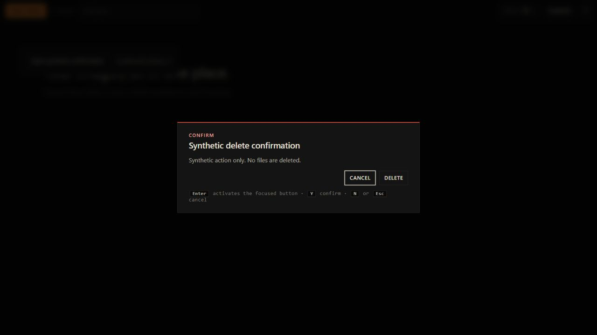

# Native command and confirmation cleanup

2026-10-28. The user authorized removal of the unused native write command (audit F01) and correction of delete-confirmation keyboard handling (part of F14).

## Changes

Removed `fs_write_bytes` from the native implementation, imports and Tauri command registration. No frontend/shim caller exists. The command's parent-only containment check is gone with the unused operation; existing file reads, deletion and exports retain their separate paths. This addresses F01, not the broader CSP/asset-protocol review in F15.

The confirmation dialog immediately focuses Cancel. Enter and Space use the focused native button's browser activation; Enter on Cancel no longer invokes Delete. Activation keys received from outside the dialog or repeated while held do not confirm. Explicit unmodified Y still confirms; N/Escape cancel. Tab/Shift+Tab cycle within the enabled dialog buttons, and closing restores the invoking control's focus when it still exists. Dialog title/description associations and keyboard hints now match this behavior. The main viewer/grid accessibility work remains separate.

## Verification

- 51 JavaScript regression tests passed across confirmation, favorites, deletion and performance suites. New confirmation tests cover immediate/default focus, focus restoration, Enter delegation, Tab cycling, repeated keys, outside focus, Y/N/Escape and blocking gallery shortcuts while a dialog is open.
- Native `cargo test --locked --offline --lib -j2`: three tests passed; the existing manual large-image smoke was ignored. The build used copying after an incremental-cache hard-link warning; there were no compile/test failures.
- Real browser keyboard checks used the app's actual dialog and global key handler with a synthetic callback counter. Enter on Cancel and Space on Cancel left the counter unchanged; Tab to Delete then Enter incremented it once; explicit Y incremented it once; Escape cancelled. Tab/Shift+Tab wrapping and focus restoration were observed. No real filesystem deletion was performed.
- JavaScript syntax, exact desktop HTML/shim composition, optimized native build and source fingerprints passed. The removed command name is absent from native/frontend source and the delivered binary. Executable format/resources, neutral PDB metadata, private metadata scan and copied checksum passed. All four earlier candidate EXEs retain their original checksums.

Visual evidence, synthetic dialog with Cancel focused:

## Build

`desktop/release/fast-gallery-v1.6.1-cleanup.exe`, Windows x64 portable release, 11,861,504 bytes. Includes the performance, blinking, deletion and favorites changes. Companion build record: `desktop/release/fast-gallery-v1.6.1-cleanup.build.json`.

SHA-256: `de78e964b70d43da9cc3fe7774e396ed9055944c31c84d48962de40d7183ed76`.

Quit the running tray instance before launching. The favorites database upgrade from the preceding build still applies; older v1 binaries are not a database rollback. User acceptance of this candidate is pending.

Historical build filenames in this report refer to preserved local artifacts. Only the latest cumulative portable EXE and its build record are versioned; see [USABILITY_WORK.md](USABILITY_WORK.md).
