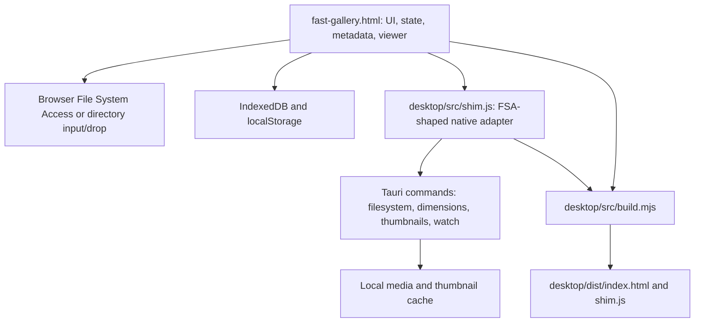

# Fast Gallery project audit

Audit date: 2026-10-28. Baseline: current working tree, including the existing compact-controls UI changes and version 1.6.1 manifests. This is an inspection and verification report; application behavior was not changed.

## Scope and confidence

Reviewed the browser application, desktop adapter, Rust filesystem and shell integration, manifests, capabilities, build composition, README, ignore rules, and repository layout. Inspected the browser empty state, gallery controls, a synthetic three-image gallery, viewer controls, prompt panel, and Escape behavior. Used synthetic inputs for targeted JavaScript and native path probes.

Evidence labels used below:

- **Reproduced:** observed in the browser or executed against functions extracted from the current source in an isolated harness.
- **Source-confirmed:** directly supported by control flow/configuration; the complete platform scenario has not been exercised.
- **Follow-up:** a risk or compatibility question requiring further measurement or platform testing.

The native application was not built or launched. `cargo check --offline --locked` could not resolve the `image` dependency from the local cache. No network dependency download, dependency vulnerability database lookup, installer execution, association registration, private-media browsing, or Git-history secret scan was performed. Release executables were inventoried, not analyzed for embedded metadata or correspondence with source. Browser testing covered the available desktop-sized viewport, not a full browser/device matrix.

Existing uncommitted changes were preserved. Local assistant configuration was not copied into this report. All paths in these notes are repository-relative; private registry hosts, account details, and machine-specific paths are intentionally omitted.

## Purpose and product character

Fast Gallery is a local media browser for large image collections, with particular depth for AI-generated images. Its central tasks are opening a directory, quickly scanning a visual grid, narrowing the collection, inspecting an original image or video, and reading/copying generation prompts.

There are two distribution modes from one frontend:

1. `fast-gallery.html`: a self-contained document that opens directly in a browser, with no frontend build, server dependency, framework, or runtime npm package.
2. Windows desktop: Tauri 2 and WebView2 wrap the same document, adding native filesystem access, cached thumbnails, live directory watching, window controls, tray operation, a global shortcut, and file associations.

There is no account system, cloud library, server database, telemetry client, or remote media service in the reviewed application source. The one frontend `fetch` is for a locally produced blob preview. Desktop media also uses local Tauri protocols. This describes the runtime source; development dependency downloads are a separate network activity.

The product is a browser/viewer with organization and export actions. Rotation is a view transform, not an edit written to the original. Disk deletion is permanent rather than a recycle-bin operation, and the confirmation explicitly says so.

## Architecture

### Frontend organization

`fast-gallery.html` is approximately 249 KB and 6,292 lines: roughly 1,140 lines of inline CSS, 315 lines of markup, and 4,825 lines of JavaScript. One strict-mode IIFE contains DOM references, mutable state, helpers, services, renderers, and event wiring. Comment banners provide the module boundaries; there are no imports or formal module interfaces.

Important state:

- `files`: canonical entry array, with name, relative path, handle/File, extension, and optional size/time/native absolute path.
- `view`: sorted and filtered array of indexes into `files`.
- `dims`, `prompts`, `colors`: parallel arrays keyed by file index; `dimsP` and `promptsP` coalesce pending work.
- `favorites`: set of relative paths; `selected`: set of numeric file indexes.
- `filterState`: sort, text, format, orientation, color, prompt-presence, favorite, folder, and recursive settings.
- `currentIndex`/`currentViewPos`: viewer location in the canonical and filtered orders.
- Grid and filmstrip each own mounted-node pools and URL caches.

This is a small application in packaging terms but a substantial stateful application in implementation terms. Numeric indexes are its main coupling point and its main source of invalidation hazards.

### Loading and rendering

Folder picker/drop -> directory walk -> collect entries and sidecars -> sort -> `resetAndLoadFiles` -> restore favorites -> `buildView` -> masonry slots -> mount viewport tiles. The FSA walk traverses directories in batches of 200; the first grid is rendered after collection/sorting, not incrementally during the whole tree walk.

Dimensions arrive in the background: first up to 400 entries at concurrency 4, then the remainder at concurrency 3. PNG/JPEG browser probes read headers; other image formats use bitmap decoding. Native dimensions use Rust header probing. Videos use a metadata-only video element with a timeout.

The masonry renderer chooses the shortest column for each item, uses a 12 px gap and 240 px minimum column width, and caps columns by both available width and the 1–12 user preference. It retains only viewport/overscan nodes, with 1,200 px overscan and a pool capped at 300 nodes. Scroll rendering and canvas drag/zoom drawing are coalesced with `requestAnimationFrame`.

### Viewer and media paths

- Static images: canvas, preferably decoded with `createImageBitmap` in a blob-backed worker. Decode request IDs discard some obsolete responses.
- Normal preview budget: 16 million pixels, 8,192 px maximum edge, 2x viewport oversampling. Full-resolution requests have a nominal 96 million pixel resize budget; failed resized decoding can retry without resizing, so this is not a strict memory ceiling.
- GIF and qualifying WebP: image overlay. WebP overlay selection depends on known size below 25 MB; many FSA entries initially lack size, so animated WebP handling needs verification.
- MP4/WebM: persistent video overlay with native playback controls; desktop streams through the asset protocol, browser uses an object URL. The mute preference persists. Hover initiates viewer playback; grid hover previews are muted, looping, delayed 150 ms, and limited to one active preview.
- Video posters: browser video/canvas capture with two concurrent jobs and a six-second timeout; native asset failure falls back to reading the whole file into an object URL.
- Filmstrip: virtualized 64 px cells, 4 px gaps, 12 cells of overscan, plus neighboring prefetch. Its URL cache is session-scoped but has no explicit size cap.
- “Fullscreen” is an in-app CSS layout mode, not a call to the browser Fullscreen API.

### Metadata and search

The app reads PNG `tEXt`, `zTXt`, and `iTXt`, and JPEG EXIF UserComment. It extracts A1111 positive prompts, selected generic prompt fields, ComfyUI API graphs and UI workflows, and Fooocus HTML sidecars. ComfyUI graph traversal has cycle checks, a depth limit of 8, node-class hints, and prompt plausibility checks. It is heuristic support for known graph shapes, not a general ComfyUI graph interpreter.

Fooocus `log.html`/`log.htm` sidecars are indexed per folder and parsed as text with regular expressions; the app does not execute those documents. Sidecar positive/negative text precedes embedded prompts and technical fields. Displayed prompt/file text generally uses `textContent`. `confirmMsg.innerHTML` currently receives application-generated messages, rather than filenames or prompt text.

Browser PNG scanning is capped at 8 MB and JPEG metadata scanning at 4 MB; the desktop head-read optimization supplies only 2 MB. Metadata later in a file can be missed. Compressed PNG text is inflated without an explicit output-size limit, which deserves malformed-input testing.

Prompt keywords use case-insensitive AND matching. Unknown prompts and unknown colors pass keyword/color filters until scanned. Prompt-presence filters require known arrays and exclude unknown entries. Orientation uses a square tolerance of 0.95–1.05. The “Filename” filter actually matches the lowercased relative path, including folder names. Color is a center-weighted average of a 32x32 sample, classified into 12 hue buckets plus neutral; it is not a histogram of all prominent colors.

### Persistence

IndexedDB database `fast_gallery`, version 1, contains `handles` and `favorites` stores. Browser FSA handles can be reopened with renewed permission. Native shim handles cannot be structured-cloned, so desktop deliberately skips saving them and tries to clear the old handle record at startup.

`localStorage` stores columns, view/filter state, and video mute. Filter state is shared across roots; loading a new root only relaxes some settings if the initial view would be empty. Prompt/color results are memory-only. Favorites are keyed by access mode plus a root label, with relative file paths as members. The code also attempts IndexedDB persistence for fallback directory input; the README's blanket “session-only” fallback claim is not reflected by a storage gate in this implementation.

### Native adapter and Rust backend

`shim.js` runs before the frontend and installs FSA-shaped `NativeDirHandle` and `NativeFileHandle` objects. It exposes narrow helpers for dimensions, file-head reads, thumbnails, asset URLs, boot paths, reveal, and watchers. This reuse is the strongest architectural decision in the repository: most product behavior stays in one implementation.

Rust stores canonical roots under generated IDs and validates most existing child paths through canonicalization and prefix checking. It lists directories, reads bytes/headers, probes dimensions, generates JPEG thumbnails, deletes files, writes files, reveals paths, and owns recursive filesystem watchers.

Thumbnail disk keys hash absolute source path, modification time, and requested maximum size. Rust decodes the full source before resizing with a triangle filter, encodes JPEG at quality 78, and caps requested thumbnails at 1,024 px. Decode limits allow 32,768 px on each side and up to 4 GiB allocation. The shim permits eight concurrent thumbnail commands; cancellation is a stub. The in-memory grid URL cache is insertion-order eviction capped at 2,048 entries, despite its LRU name; reads do not refresh recency. The on-disk thumbnail cache has no cleanup policy.

Native watchers debounce for 300 ms; frontend events are batched for another 400 ms. Each refresh re-walks the whole root, then attempts to restore cached attributes, selection, viewer position, and scroll anchor by relative path.

`lib.rs` wires Tauri commands/plugins, a frameless dark window, close-to-tray, a tray menu, Ctrl+Alt+G, cold-launch arguments, and second-instance forwarding. `assoc.rs` installs/removes per-user registry entries for supported image and video extensions. The implementation is Windows-oriented even though some modules have platform guards.

## Repository and change map

| Location | Responsibility / editing guidance |
|---|---|
| `fast-gallery.html` | Authoritative browser UI and shared frontend. Edit here, not generated `dist`. |
| `desktop/src/shim.js` | Browser/native contract and native media optimizations. |
| `desktop/src/build.mjs` | Copies HTML and injects the shim script before `</head>`; no bundler. |
| `desktop/src-tauri/src/fs_commands.rs` | Filesystem authorization boundary, media IO, thumbnail cache, watcher. |
| `desktop/src-tauri/src/lib.rs` | Desktop lifecycle, plugins, command registration, tray, argv forwarding. |
| `desktop/src-tauri/src/assoc.rs` | Windows file associations. |
| `desktop/src-tauri/src/main.rs`, `build.rs` | Thin Rust entry points. |
| `desktop/src-tauri/tauri.conf.json` | Window, app identity, asset protocol, security, installer targets. |
| `desktop/src-tauri/capabilities/default.json` | Window/dialog/shortcut permissions. |
| `desktop/package.json`, `package-lock.json` | Node build commands and locked Tauri CLI dependencies. |
| `desktop/src-tauri/Cargo.toml`, `Cargo.lock` | Native dependencies, features, Rust package version. |
| `desktop/src-tauri/icons/icon.ico` | Application icon. No separate frontend asset library. |
| `desktop/dist/`, `desktop/node_modules/`, native `target/` and `gen/` | Ignored generated/local dependencies and output. |
| `desktop/release/` | Copied release executables; one older portable executable is tracked, newer binaries are untracked. |
| `README.md`, `LICENSE` | Usage/product claims and MIT license. |
| `.claude/` | Existing untracked local assistant settings; not product documentation or a source of authorization. |

At audit start, README, HTML, package manifests/locks, and Tauri configuration already had changes. Do not attribute them to this audit or revert them while addressing findings. There is no committed test suite, lint/type-check setup, CI workflow, dedicated changelog, or release verification workflow in the inspected tree.

### Frontend navigation anchors

Line numbers describe the audited baseline and will move after edits; use the function names as durable anchors.

| Approximate line | Area |
|---|---|
| 8 / 1084 | Original design tokens and later compact-controls overrides |
| 1149 / 1340 | Gallery and viewer markup |
| 1595 / 1649 | Shared state and IndexedDB |
| 1698 / 1893 | FSA walking and dimension probing |
| 2017 / 2233 / 2364 | Prompt extraction, binary metadata, sidecars |
| 2497 / 2570 | Color sampling and filter state |
| 2648 / 2745 | `buildView` and virtualized masonry |
| 2798 / 2957 | Hover previews and video posters |
| 3242 / 3287 | Selection and deletion |
| 3440 / 3630 / 3804 | Canvas viewer, worker decode, prompt panel |
| 3870 / 3937 / 4161 | Slideshow, filmstrip, viewer lifecycle |
| 4389 / 4514 / 4730 | Shared controls, shortcuts, grid events |
| 4969 / 5091 / 5289 | Filter wiring, folder navigation, scans |
| 5421 / 5553 / 5584 | ZIP writer, loader, status title |
| 5641 / 5814 / 6079 | Root load/reset, live refresh, drop fallback |

## Design philosophy and visual style

Observed principles: local ownership, minimal setup, dense inspection tools, media-first use of space, keyboard speed, and progressive disclosure of less frequent controls. Performance is addressed explicitly with virtualization, lazy work, caching, worker decoding, and native header/thumbnail services. These principles are inferred from the implementation and documentation, not a separately authored design brief.

The interface resembles a compact dark utility with editorial details:

- Background `#0a0a0a`, raised surfaces `#141414` and `#1c1c1c`, warm primary text `#e6e2d8`, dim text `#b8b3a7`, muted text `#7a756c`.
- Orange signal `#d97b2a`, lighter orange text `#f4b57a`; red danger `#d84a3a`; gold favorites `#f2c14e`. Folder depth adds restrained colored top borders and a legend.
- System sans-serif for UI, system monospace for dimensions, counts, paths, shortcuts, and prompts. No webfonts.
- Square controls, hairline warm-gray borders, little ornamental imagery, translucent blurred overlays, modest panel shadows.
- Effective main control height is 30 px. Earlier CSS/comments describe 28 px uppercase controls, but the later compact-controls rules override much of that to 12 px sentence-case labels. Eyebrows remain small uppercase tracking. Preserve the effective current style rather than copying an obsolete comment.
- Fixed compact gallery bar exposes Open folder, counts, filename search, Select, Controls, and help. Selected-item actions appear contextually. Folder breadcrumbs/chips form a secondary row only when relevant.
- A floating gallery Controls panel holds display/scanning/sort/filter settings and reports active filters on its trigger.
- Viewer controls reuse the original button groups by moving them into one panel at startup: Browse and playback, Image actions, View and help. The same panel serves normal and in-app fullscreen modes.
- The empty state uses an orange index mark, a small brand eyebrow, a large warm heading, and restrained guidance. The grid/viewer reserve the main area for media.

Responsive rules exist at 600 px: filename search wraps, some counts/dimensions hide, and panels use viewport limits. This remains a desktop-first product; native minimum window dimensions are 800x600. Confirm dialogs still have a 340 px minimum content width plus outer padding, which needs testing on narrow phones.

Accessibility foundations include native buttons, switch roles and keyboard activation, accessible names derived from titles, focus-visible styling, dialog attributes, and some polite status announcements. They are incomplete; see F14. Reduced-motion handling currently addresses the loader sweep, not every animation/scrolling interaction.

## Findings and priorities

Priority is relative to this project. P1 means address before relying on the affected correctness/security boundary; P2 means material behavior or usability work. Findings do not imply remote exploitability or a completed platform certification.

### F01 — P1: native write command escapes the registered root

**Reproduced with extracted Rust functions**, using only a disposable directory inside the workspace. `fs_write_bytes` in `desktop/src-tauri/src/fs_commands.rs:271` validates the parent obtained by splitting on `/`, then joins an unchecked final filename. On Windows, a backslash traversal in that filename escapes the parent. An existing target symlink is also not checked by the parent-only validation.

`resolve_child` protects most other existing-path operations, but this write path bypasses it for the target. The command is registered in `lib.rs:165`; no current frontend caller was found. This is a latent exposed-command boundary defect, not evidence that the regular gallery UI writes outside a chosen folder. Remove the unused write command or validate path components, target containment, and symlink/reparse behavior before retaining it.

### F02 — P1: failed deletions are presented as removed

**Reproduced with the extracted JavaScript deletion function and a denied-delete stub.** `performDeleteIndexes` at `fast-gallery.html:3333` records failed filesystem deletions but builds `removeSet` from every requested index. Failed items disappear from the gallery and favorites anyway; failures only reach the console. Keep failed items visible and present actionable per-item results. This also matters because browser folders are initially requested in read mode and deletion may require additional permission.

### F03 — P1: file removal corrupts index-keyed thumbnail associations

**Reproduced with the extracted deletion function and synthetic URL mappings.** Deletion compacts `files` and remaps dimension/prompt/color arrays, but leaves `thumbUrlByIdx` keyed by the previous indexes. After deleting the first file, the new first tile can display the old first file's thumbnail. Filmstrip caches/pending work have the same identity hazard. Use stable file identities or invalidate/remap every cache together before rerendering.

### F04 — P1: asynchronous work can cross dataset boundaries

**Reproduced for `ensureDims` with a controlled late native response.** A request started for the old file at index 0 writes into `dims[0]` after `files` and `dims` are replaced for another root. Reset and deletion do not give dimension/prompt/poster/filmstrip jobs a shared generation token. Thumbnail guards compare numeric indexes, which can be reused by a new dataset. `openViewer` also resumes after `await ensureDims` without checking that its open request is still current. Add a dataset generation and stable entry checks at every async completion, including error paths and worker submission.

### F05 — P2: small folders retain square placeholder layouts

**Reproduced in the browser.** Three files with dimensions 960x480, 400x800, and 500x500 all remained in 286x286 slots after their dimension labels were correct. The first-dimension pass at `fast-gallery.html:5736` schedules `renderVisible`, which does not recompute slots. For collections of 400 files or fewer, `ensureRestDimsInBackground` returns without `applyFilters`. Recompute geometry as dimensions arrive and on completion. Larger collections can also retain placeholders until the remainder finishes.

### F06 — P2: visibility binary search assumes an invalid ordering

**Reproduced with the extracted `firstVisibleSlotIndex` and synthetic masonry intervals.** Slots are sorted by top, but the binary-search predicate compares bottom edges. Bottom edges are not monotonic when tall and short images share a grid, so an overlapping tall tile can be skipped. Use per-column searches, a prefix maximum of bottoms, or another interval-aware structure. Preserve correctness when scrolling past very tall artwork.

### F07 — P2: favorites collide between equally named roots

**Source-confirmed.** `loadViaFSA` at `fast-gallery.html:5767` uses `fsa:` plus the root's basename as its storage key; refresh repeats that choice. Two distinct directories with the same name share their favorites set, and equal relative paths can appear favorited in both. Drop and fallback modes have similar label-based identities. Use a stable local root identity; browser handle equivalence and a persisted opaque identifier are possible building blocks. Avoid publishing real absolute paths when diagnosing this.

### F08 — P2: native first-run IndexedDB schema can be created empty

**Source-confirmed initialization order; full native fresh-profile run pending.** At `desktop/src/shim.js:315`, the shim opens database version 1 without an upgrade handler. On a fresh profile it can create that database with no stores before frontend `openIdb` at `fast-gallery.html:1649` opens the same version. The frontend then receives no upgrade event and cannot create `handles`/`favorites`. Coordinate schema ownership or initialize required stores in the first opener. Separately, `idbPut` reports request success before transaction completion, so a later transaction abort is not accurately reflected.

### F09 — P2: live refresh restores stale data by path alone

**Source-confirmed.** `refreshFilesFromRoot` at `fast-gallery.html:5814` restores dimensions, prompts, and colors whenever a relative path remains present, even if that file was overwritten or a sidecar changed. Restoration occurs after `resetAndLoadFiles` has already filtered/rendered and started new background jobs; there is no immediate filter/layout rebuild after restoration. This combines stale content, transient incorrect filtering, and async races. Compare file fingerprints and coordinate refresh as one state transition, then derive the view from the restored/invalidated state.

### F10 — P2: completing a prompt scan does not reapply keyword filtering

**Source-confirmed.** Unknown prompts pass keyword matching in `buildView`. At `fast-gallery.html:5289`, scan completion only calls `applyFilters` if the prompt-presence filter is active; with keyword search alone it calls `renderVisible`. Items proven not to match can therefore remain until another action rebuilds the view. Reapply all filters that depend on newly populated metadata.

### F11 — P2: advertised native media support has implementation gaps

**Source-confirmed; platform fixtures still needed.** AVIF is accepted by frontend, argv, and associations, but the Rust `image` dependency does not enable an AVIF decoder. Native `fs_thumb` failure marks the tile errored without browser-image fallback. Also, Rust fallback previews are requested at 2,048 px but `fs_thumb` clamps to 1,024. `tryRustPreview` is reached only from the non-worker decode branch; the normal worker failure handler directly shows “Decode failed.” The README's large-image rescue claim therefore does not cover the normal worker path. Test format parity and route native/browser fallbacks consistently. Test EXIF rotations and transparency too: native thumbnails are JPEG and the thumbnail function does not explicitly apply EXIF orientation.

### F12 — P2: ZIP implementations disagree and mishandle names

**Reproduced by inspecting bytes from an archive made by the extracted writer.** `buildZip` at `fast-gallery.html:5442` emits duplicate entry names for images with equal basenames in different folders; streaming export uses `zipNameForIndex` to deduplicate. Both encode names as UTF-8 but leave the UTF-8 flag unset, risking garbled non-ASCII names in readers. The fallback cap is 512 MB, streaming cap 2 GB; both load an entire file to calculate CRC before writing it. File count is written into 16-bit ZIP fields without a count guard/ZIP64. A canceled save picker falls through to the download fallback. Share one archive-entry policy and make limits/cancel behavior explicit.

### F13 — P2: native metadata optimizations still have expensive bypasses

**Source-confirmed, scale measurements pending.** Directory listings already carry size and modification time, and native handles retain them, but `walkDirectoryFSA` initializes entry size/time to `undefined`. `ensureSortDataFor` then calls `getFileForEntry` with concurrency 32, transferring whole native files just to sort by size/date. Color scanning reads full files rather than using native thumbnails. Prompt-scan estimation samples full files despite the 2 MB head-read scan path. Preserve stat metadata and use small native previews for sampling. Thumbnail queues have no cancellation/backpressure and may spend time decoding obsolete requests. Eight simultaneous full image decodes with the raised allocation ceiling deserve explicit memory-budget testing.

### F14 — P2: keyboard and modal accessibility is incomplete

**Source-confirmed and partly observed in browser accessibility state.** Main tiles, stars, prompt chips, and filmstrip cells are clickable divs without equivalent focusable/semantic activation. Viewer/confirmation dialogs lack a complete focus trap, accessible title association, background inertness, and reliable focus restoration. The browser accessibility tree still exposes gallery controls beneath the open viewer. Opacity-hidden “Prompt copied” is exposed before a copy action. Add keyboard opening/navigation for media, semantic favorite/prompt controls, dialog focus management, and test the confirmation Enter behavior carefully: global Enter confirms deletion even when Cancel initially has focus. This is not a completed WCAG audit.

### F15 — security and privacy work before distribution

**Source-confirmed configuration; no remote exploit or binary leak assessment performed.** Tauri CSP is disabled and the asset protocol scope is unrestricted (`desktop/src-tauri/tauri.conf.json:30`). The custom root validation therefore does not cover every way frontend code can access local assets. `fs_open_root` also accepts a caller-provided path for boot integration. Treat the webview as privileged and minimize unused commands/protocols, constrain asset access where feasible, and add an appropriate CSP after accounting for inline code and blob workers.

The npm lockfile includes private registry endpoints in 12 resolved package entries. Before any outgoing action, review and sanitize that metadata without copying the endpoint values into reports. Existing local assistant settings are untracked and should not be accidentally included. Several console errors log raw filenames, paths, or native IO errors, and built executables may carry machine/source metadata; inspect actual exported content and binaries rather than assuming source-only redaction is sufficient. No public Git identity has been approved in this conversation, so a later commit must not inherit local author/committer defaults without checking authorization.

## Maintenance and documentation observations

- Shared frontend/adaptation boundary is worth preserving; a wholesale framework migration is not a prerequisite for fixing these findings.
- The single IIFE makes cross-feature invalidation and testing difficult. Extract pure metadata/filter/layout logic behind stable interfaces incrementally, while preserving the single-file browser deliverable through deterministic composition if modules are introduced.
- CSS contains a later override layer for compact controls. Consolidate only after preserving the effective appearance; stale comments already disagree with current metrics/casing.
- The thumbnail cache called LRU is FIFO by insertion. Filmstrip and disk caches have no cap/expiry, roots stay registered for the process lifetime, and stopped roots' directory caches are not explicitly retired.
- Some APIs/helpers are unused or transitional: native write and recursive list commands, `__fgThumbCancel` stub, shim extension regexes/`encodeRel`, and the legacy awaited first-dimensions helper. Confirm consumers before removing anything.
- The cold-boot comment in `lib.rs:248` describes an initialization script and eval, but the implementation shown only uses `win.eval`. Test first launch versus second-instance forwarding for timing races. Tray “Show / hide” currently calls the show/focus helper rather than toggling visibility. These remain follow-up platform checks.
- README format and association lists lag video support; the color list describes one more hue bucket than the implementation; ZIP limits and browser fallback persistence claims need alignment. “Reopen last folder” is principally a browser FSA capability, not current native-handle persistence.
- Version 1.6.1 is repeated across package/lock, Cargo/lock, and Tauri config. There is no automated release provenance check linking copied executables to this working tree. The older tracked executable and newer untracked artifacts require deliberate release hygiene.

## Verification performed

| Check | Result |
|---|---|
| Parse shared gallery JavaScript and desktop shim with Node | Passed |
| Parse package, lockfile, Tauri config, and capabilities JSON | Passed |
| Compose desktop web output using the actual build script | Passed; output equals source plus the expected shim insertion; copied shim equals source |
| Static duplicate HTML IDs and static `getElementById` targets | No duplicate IDs or missing referenced targets found |
| Browser empty state and gallery Controls panel | Rendered; opening panel focused Close |
| Synthetic image gallery and dimension labels | Rendered; reproduced F05 |
| Viewer, shared Controls, PNG prompt, Escape-to-close-controls | Worked for synthetic files; Escape restored focus to Controls |
| Browser warning/error logs during synthetic viewer test | None observed |
| Extracted JavaScript probes | Reproduced F02, F03, F04, F06, and both duplicate-name/UTF-8 aspects of F12 |
| A1111 positive text and simple ComfyUI graph extraction probes | Passed |
| Extracted native path/write functions, standard-library Rust harness | Reproduced F01 inside disposable workspace fixture only |
| Full native `cargo check --offline --locked` | Blocked by locally unavailable `image` dependency; no app compilation result |

Temporary probes and synthetic media were used only for inspection and removed afterward. Generated ignored desktop web output was rebuilt; source files and existing user changes were preserved.

## Suggested next work

1. Repair the write boundary, truthful delete results, cache identity, and dataset cancellation together with targeted regression coverage.
2. Repair dimension-driven layout and tall-image visibility, then prompt/live-refresh invalidation and persistence identity/schema ownership.
3. Verify native AVIF, worker fallback, EXIF orientation, animated formats, and large-image memory use; avoid full-file reads for stat/color work.
4. Improve keyboard/dialog access and ZIP naming/limits, then align README claims with verified behavior.
5. Once dependencies are available, run a native build and exercise tray, first-run storage, cold/second launch, watcher refresh, video seeking, and installer/file associations in a disposable profile.
6. Before committing or distributing anything, inspect actual content and metadata for private identifiers, use only an explicitly approved public identity, sanitize registry metadata, and establish release provenance.

Keep future changes small enough to preserve the local-first, shared-codebase, compact media-inspection character of the app.
