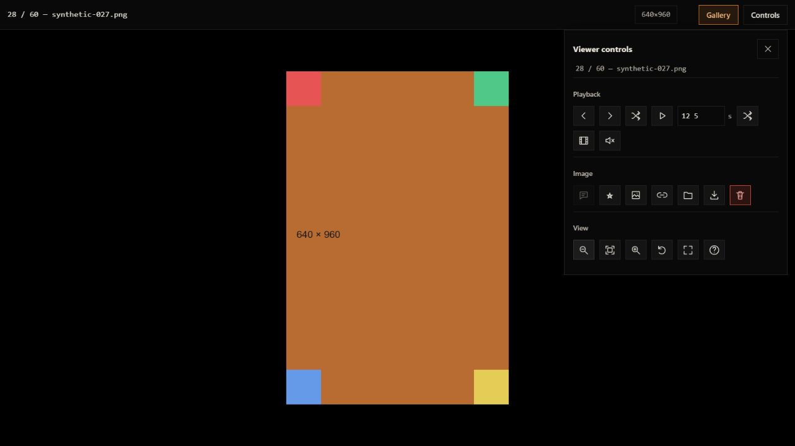

# Viewer and gallery usability pass

2026-10-29. Implements the user's twelve-item usability list on top of the performance, deletion, favorites and native-command cleanup passes.

| Report | Change |
|---|---|
| Old image flashes when another file is opened from the tray | Native second-instance image dispatch hides the retained window before forwarding the target. The frontend clears old bitmap/overlays before awaiting dimensions, prepares the requested viewer, then presents/unminimizes/focuses the window. External-open request IDs prevent an older request from presenting ahead of a newer one. Opening a root still being scanned does not reuse its previous file list. |
| Filmstrip opens automatically | Removed automatic activation. New viewer sessions begin with it closed; T or its icon opens it. |
| Cannot zoom below fit or inspect corners freely | Zoom range is 5%–3200% of fit. Panning allows every image corner to reach viewport center, including the short axis and rotated images. Pointer panning also works below fit. Small animated-image overlays use the same view transforms; video controls retain normal pointer handling. |
| No direct route to gallery | Added an orange-accented **Gallery** button beside **Controls**, always available in the viewer, including fullscreen. |
| Slideshow speed is undiscoverable/fixed | Added a numeric seconds field: 0.25–3600 seconds, persisted locally, editable during playback. Existing Alt-click interval cycling remains available. Typing into controls no longer triggers viewer zoom/rotation shortcuts. |
| Image copying includes viewport black bars | Added source-image PNG copying via its own canvas at image dimensions. C/Ctrl+C and the viewer's image icon copy pixels; image/folder paths remain separate actions. Right-clicking the image opens app copy/download actions instead of the canvas's viewport-copy menu. Source re-encoding omits viewport/background and embedded source metadata. |
| Inconsistent, verbose controls | Viewer actions use a shared monochrome SVG icon style with titles/accessible names, grouped into Playback, Image and View. Gallery action icons and close buttons use the same treatment. Gallery/Controls navigation remains text. Prompt, mute, slideshow and fullscreen state updates preserve the icons. |
| Include subfolders should default off | Default/reset are off, with a one-time preference migration from the earlier implicit-on default. Explicit choices in the new version are saved. Empty-root guardrails no longer switch recursion on behind the user's back. |
| Scanning toggles make controls move | Fixed gallery scan rows and reserved progress columns; estimates are positioned within the fixed row. |
| Fullscreen is only full-window | Replaced CSS-only toggling with Tauri's native window fullscreen API and the browser Fullscreen API. CSS follows actual fullscreen state. Native permissions add only fullscreen and unminimize window operations. Exit requests are serialized with entry; failed requests do not claim success. |
| Viewer controls remain stuck after returning to gallery | Explicit hidden state accompanies the panel class. Closing the viewer closes both control panels and its image context menu; opening a fresh viewer also resets panel state. |
| Columns 9–12 behave identically | Removed the implicit 240 px column-width cap. The slider now requests the actual 1–12 column count. |

## Copying limits

Image copy uses original oriented pixel bounds, independently of current zoom, pan and viewport aspect ratio. It creates a still PNG; animation is not copied. To avoid undoing the earlier large-image memory work, copying rejects sources above 64 million pixels or a 16,384 px edge, and sources with unavailable dimensions. It reports the limit/clipboard failure and points to Download original. Viewing and native preview limits remain separate. Native AVIF support and ICC fidelity remain existing audit work.

## Verification

- 60 JavaScript tests pass. New tests cover explicit column counts, zoom/pan bounds and rotation, default/preference migration, editable slideshow timing, source-sized clipboard encoding and early size rejection, native/browser fullscreen entry/exit/denial, external-open presentation ordering, and clearing the retained bitmap before asynchronous dimension work.
- Native `cargo test --locked --offline --lib -j2`: three tests passed; the existing manual large-image smoke was ignored. An incremental-cache hard-link warning fell back to copying.
- Real browser smoke checks used 60 synthetic images. The filmstrip began closed. Copying a portrait and reading it back through the browser clipboard yielded **640 × 960**, matching the source rather than the landscape viewport. Zoom below fit and moving the top-left image corner to viewport center were observed. Slideshow advanced at 0.5 seconds and accepted 12.5 seconds. Actual browser fullscreen expanded to the monitor; Gallery exited it. The gallery rendered 12 unique column positions. Toggling prompt/color scans retained surrounding controls' geometry. Viewer controls were hidden after returning to Gallery.
- Browser automation's read-only DOM mirror did not expose `document.fullscreenElement` accurately; the actual fullscreen screenshot/viewport change and runtime API path were used for that check.
- The native second-instance tray transition and Windows monitor fullscreen were implemented and compiled but were not exercised against a live Windows gallery instance. They should be the first checks in the new EXE. The user's real media and existing running instance were not used for browser tests.

Visual evidence with synthetic media:

All earlier fixes are retained. Broader audit items in the working notes remain separate; this pass does not add NSFW filtering.

## Build

Final cumulative Windows x64 portable release: [fast-gallery-v1.6.1-usability.exe](../desktop/release/fast-gallery-v1.6.1-usability.exe), 11,726,336 bytes. Companion record: `desktop/release/fast-gallery-v1.6.1-usability.build.json`. The earlier `usability-fix` artifact was an intermediate build; use this final executable.

SHA-256: `46f80b84179187e6fc0a9d32b2661dfceafe36d5f32ff53428be7164883e84a1`.

Optimized build, exact HTML/shim composition, inline JavaScript syntax and source fingerprints passed. The x64 GUI executable, neutral PDB metadata, private metadata scan and copied checksum passed; product/version/company resources were also checked. All five earlier delivered executables retain their checksums. Quit the running tray instance before launching the new EXE. The previous favorites database upgrade still applies. User acceptance is pending.
